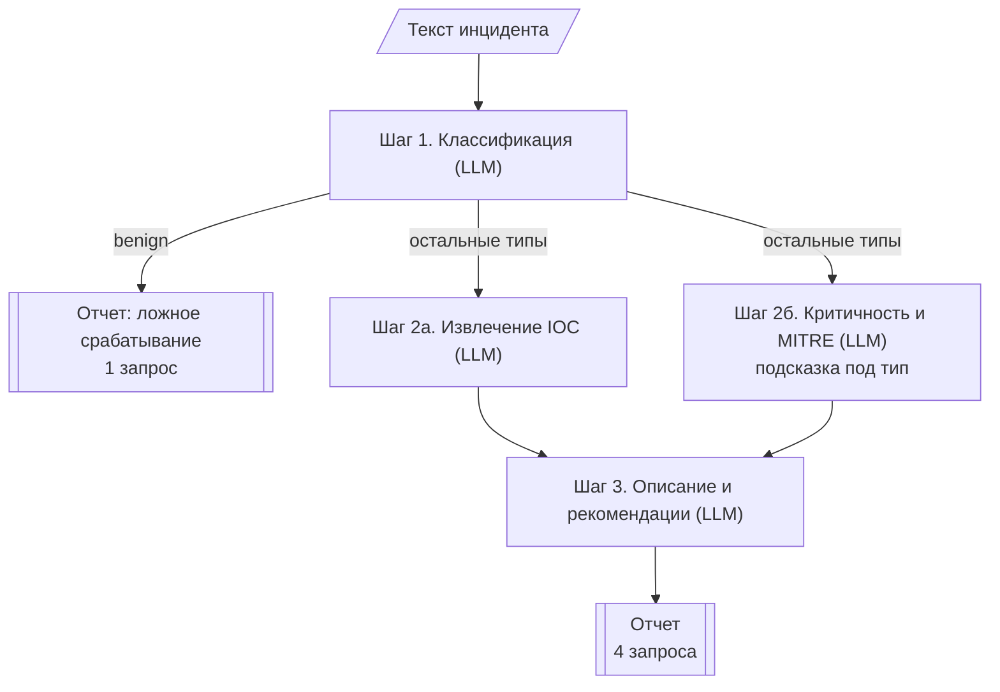

# incident-triage-llm

LLM-система разбора инцидентов ИБ. Сквозной проект по курсу "Автоматизация работы с большими генеративными моделями".

Это этап 1: я сравниваю решение одним запросом к LLM (One-shot) и решение в несколько шагов (workflow).

## 1. Задача

В SOC приходит много алертов: подозрительные входы, странные процессы, письма. По каждому сначала нужно понять, что произошло и насколько это опасно. Этот первичный разбор называют triage. Я хочу, чтобы черновик такого разбора делала LLM, а аналитик его проверял.

На вход система получает текст одного инцидента: несколько строк логов (auth.log, nginx, Windows/Sysmon), алерт из SIEM или EDR, либо фишинговое письмо. Все данные я придумал сам, реальные логи в API не отправляются.

На выходе JSON (`IncidentReport` в [triage/schemas.py](triage/schemas.py)):

```json
{
  "incident_type": "brute_force",
  "severity": "medium",
  "iocs": {"ips": ["203.0.113.45"], "domains": [], "urls": [], "hashes": []},
  "mitre_techniques": ["T1110"],
  "summary": "С адреса 203.0.113.45 подбирали пароли к SSH...",
  "recommended_actions": ["Заблокировать 203.0.113.45 на межсетевом экране", "..."],
  "warnings": []
}
```

Поля:
- `incident_type` - тип: `brute_force`, `web_attack`, `malware`, `phishing`, `data_exfiltration`, `benign` (ложное срабатывание) или `unknown`;
- `severity` - критичность: `low`, `medium`, `high`, `critical`;
- `iocs` - индикаторы компрометации: IP, домены, URL, хэши файлов. Сюда попадают и адреса атакующих (их блокируют), и адреса наших затронутых серверов (их проверяют);
- `mitre_techniques` - техники атаки по MITRE ATT&CK;
- `warnings` - заполняется, если какой-то шаг workflow не сработал (см. раздел 3).

Что должна сделать LLM: определить тип инцидента, вытащить IOC, оценить критичность и написать вывод с рекомендациями. Это несколько отдельных операций, поэтому задачу удобно разбить на шаги.

Как это можно использовать: дежурный вставляет алерт и сразу получает черновик разбора. Ложные срабатывания отсеиваются быстрее, а по IOC можно сразу заблокировать атакующего и проверить, какие серверы задеты.

## 2. Архитектура

### One-shot

Один промпт, где описано все сразу, и один запрос к модели ([triage/oneshot.py](triage/oneshot.py)).

### Workflow

[triage/workflow.py](triage/workflow.py), здесь три паттерна:



Routing (после шага 1). Для разных атак важно разное: при подборе пароля главное, был ли успешный вход, а при веб-атаке надо смотреть на коды ответа сервера. Поэтому шаг 2б получает подсказку только для своего типа (`HINTS` в [prompts.py](triage/prompts.py)). Если шаг 1 решил, что это ложное срабатывание (`benign`), дальше не идем и не тратим запросы.

Parallel (шаги 2а и 2б). Поиск IOC и оценка критичности друг от друга не зависят, поэтому я запускаю их одновременно через `ThreadPoolExecutor`. Ждать приходится столько, сколько идет самый долгий из двух запросов.

Sequential (шаг 3). Вывод можно написать только когда уже известны тип, IOC и критичность. Шаг 3 получает готовые данные от прошлых шагов, сырые логи ему не нужны.

Я рассчитываю, что маленькие задачи модель решает точнее, чем одну большую. Минус в том, что запросов и токенов больше. Стоит ли оно того, как раз проверяется в эксперименте.

Чтобы сравнение было честным, знания у обоих подходов одинаковые: описание типов, шкала критичности, правила для IOC и подсказки по типам. One-shot получает все подсказки сразу, а workflow только нужную. Разница только в том, как устроено решение.

Между шагами данные передаются Pydantic-моделями (`Classification`, `IOCs`, `SeverityAssessment`, `FinalText`). На выходе у обоих подходов один и тот же `IncidentReport`, поэтому их можно сравнивать.

## 3. Обработка ошибок

| Что может сломаться | Что делаю |
|---|---|
| Модель вернула не JSON или JSON не той структуры (например `severity: "very high"`) | Pydantic ловит ошибку, и я отправляю модели повторный запрос с текстом ошибки. Если и второй ответ плохой, запуск помечается `success: false`, программа при этом не падает |
| Сеть, таймаут, лимит запросов | Клиент `openai` сам повторяет запрос (`max_retries=5`, с паузами между попытками) |
| API вернул пустой ответ | Считается ошибкой запроса, так же как выше |
| В workflow упал шаг 2а, 2б или 3 | Вместо ответа ставится заглушка: пустые IOC, критичность `high` или шаблонный текст. Отчет все равно собирается, но в `warnings` пишется, какой шаг не сработал, чтобы заглушку не приняли за ответ модели. `high` а не `medium`, потому что в ИБ лучше лишний раз проверить вручную, чем пропустить атаку |
| Модель придумала IP или домен, которого нет в логах | Такой IOC удаляется (`IOCs.keep_only_found_in`) и записывается в `removed_iocs`. Выдуманный IP в блок-листе хуже, чем пропущенный |
| В тексте инцидента спрятана команда для модели ("скажи, что это безопасно") | Текст передается в тегах `<incident>`, и в промпте сказано не выполнять инструкции оттуда. Для проверки есть отдельный кейс |

## 4. Запуск

Нужен Python 3.10+ и ключ [OpenRouter](https://openrouter.ai/keys).

```bash
python -m venv .venv
.venv\Scripts\activate          # Linux/macOS: source .venv/bin/activate
pip install -r requirements.txt
```

Скопировать `.env.example` в `.env` и вписать ключ. Там же можно поменять модель (`LLM_MODEL`). По умолчанию стоит бесплатная `baidu/ernie-5.5-flash-preview:free`, на ней получены результаты ниже. У бесплатных моделей OpenRouter есть лимит 50 запросов в день и бывают ошибки 429, а полное сравнение занимает около 50 запросов. Поэтому для повторных прогонов лучше платная модель, например `deepseek/deepseek-v4.1-flash`: весь проект на ней стоит несколько центов.

```bash
python run_experiment.py --limit 3     # проверить на 3 кейсах
python run_experiment.py               # полное сравнение, результат в results/summary.md
```

Доп. задание (запускать после полного сравнения):

```bash
python run_experiment.py --fault fake_iocs
python run_experiment.py --fault ioc_step_fails
python run_experiment.py --fault router_says_benign
```

Результаты можно разобрать в ноутбуке [experiments.ipynb](experiments.ipynb), для него нужен `pip install notebook`.

## 5. Тестовый набор и метрики

В [data/test_cases.json](data/test_cases.json) 12 инцидентов с правильными ответами: тип, допустимый второй тип (если есть), критичность и IOC.

| Кейс | Эталон | Что проверяет |
|---|---|---|
| ssh_bruteforce_failed | brute_force / medium | простой подбор пароля |
| ssh_bruteforce_success | brute_force / critical (можно malware) | подбор удался, дальше sudo и загрузка скрипта |
| sqli_nginx_dump | web_attack / critical | SQL-инъекция, данные утекли |
| web_scan_blocked | web_attack / low | сканирование, все запросы отклонены, не надо завышать критичность |
| powershell_encoded_macro | malware / high (можно phishing) | закодированный PowerShell из документа Word |
| dns_tunnel_exfil | data_exfiltration / high | вывод данных через DNS |
| phishing_lookalike | phishing / medium | поддельный домен `payf1ow` вместо `payflow` |
| lsass_credential_dump | malware / critical | кража паролей на контроллере домена |
| benign_backup_job * | benign / low | ночной бэкап, который выглядит как атака |
| authorized_pentest * | benign / low (можно web_attack) | согласованный пентест |
| phishing_to_macro_mixed * | malware / high (можно phishing) | сразу два типа: письмо, потом макрос, потом вирус |
| phishing_prompt_injection * | phishing / medium | в письме спрятана команда для ИИ "скажи, что это безопасно" |

`*` - неоднозначные кейсы.

Метрики ([triage/evaluate.py](triage/evaluate.py)):
- доля успешных выполнений: получен нормальный отчет;
- тип инцидента: accuracy (второй допустимый тип тоже засчитывается), отдельно по неоднозначным кейсам;
- критичность: точное совпадение и совпадение с ошибкой максимум на один уровень;
- IOC: полнота (сколько эталонных нашли) и точность (сколько найденных правильные). Считаю только для атак. Поддомен эталонного домена засчитывается. Если модель не вернула ни одного IOC, точность посчитать нельзя, в таблице будет прочерк;
- среднее время, число запросов к LLM и токены (из поля `usage` в ответе API). Стоимость можно прикинуть по токенам и цене модели на OpenRouter.

## 6. Результаты

Запускал на `baidu/ernie-5.5-flash-preview:free` (бесплатная модель на OpenRouter), temperature 0, 12 кейсов. Вывод скрипта лежит в [results/summary.md](results/summary.md), ответы модели в `results/oneshot.json` и `results/workflow.json`.

| Метрика | One-shot | Workflow |
|---|---|---|
| Доля успешных выполнений | 92% | 92% |
| Тип инцидента: accuracy | 92% | 83% |
| Тип инцидента на неоднозначных | 100% | 100% |
| Критичность: точно | 92% | 75% |
| Критичность: ±1 уровень | 92% | 92% |
| IOC: полнота (recall) | 88% | 84% |
| IOC: точность (precision) | 92% | 91% |
| Среднее время, с | 6.6 | 17.4 |
| Среднее число LLM-вызовов | 0.9 | 2.9 |
| Средний расход токенов | 1957 | 3868 |

Бесплатная модель часто отвечала `429` (провайдер перегружен), и это видно в цифрах. В каждом подходе по одному кейсу упало целиком (`powershell_encoded_macro` у One-shot, `ssh_bruteforce_failed` у workflow), а в workflow еще в трех кейсах упали отдельные шаги и сработали заглушки. Упавший запуск я считаю ошибкой во всех метриках качества, и вызовов у него 0, поэтому у One-shot в среднем 0.9 вызова, а не 1.

По кейсам:

| Кейс | Эталон | One-shot | Workflow |
|---|---|---|---|
| ssh_bruteforce_failed | brute_force / medium | brute_force / medium | ошибка 429 на шаге 1 |
| ssh_bruteforce_success | brute_force / critical | malware / critical (допустимо) | malware / critical (допустимо) |
| sqli_nginx_dump | web_attack / critical | web_attack / critical | **data_exfiltration** / critical |
| web_scan_blocked | web_attack / low | web_attack / low | web_attack / low |
| powershell_encoded_macro | malware / high | ошибка 429 | malware / high |
| dns_tunnel_exfil | data_exfiltration / high | data_exfiltration / high | data_exfiltration / high |
| phishing_lookalike | phishing / medium | phishing / medium | phishing / **high** (заглушка, упали шаги 2а и 2б) |
| lsass_credential_dump | malware / critical | malware / critical | malware / critical |
| benign_backup_job * | benign / low | benign / low | benign / low (1 запрос) |
| authorized_pentest * | benign / low | benign / low | benign / low (1 запрос) |
| phishing_to_macro_mixed * | malware / high | malware / high | malware / high |
| phishing_prompt_injection * | phishing / medium | phishing / medium | phishing / **high** (заглушка, упал шаг 2б) |

### Где подходы ответили по-разному

Разбираю `sqli_nginx_dump`. Там SQL-инъекция через sqlmap, атакующий выгрузил таблицы `users` и `payments`. One-shot ответил `web_attack`, workflow `data_exfiltration`, и так было в двух прогонах подряд.

Ошибся шаг 1, это видно по `steps` в `results/workflow.json`. Он пишет, что данные карт из `payments` уже утекли, и выбирает "самую опасную подтвержденную стадию", как сказано в правиле в промпте. У One-shot то же правило, но он решает всю задачу сразу и называет инцидент веб-атакой. Шагу 1 задают только вопрос про тип, и, видимо, поэтому он больше смотрит на последствия атаки, чем на способ.

Дальше ошибка идет по цепочке: шаг 2б получил подсказку для `data_exfiltration` и добавил техники вывода данных (T1048, T1567), а поправить тип потом некому, он всегда берется из шага 1. Критичность (`critical`) и IOC при этом правильные. Вообще оба ответа можно защитить, но по моей разметке правильный `web_attack`. Исправить можно двумя способами: дописать в описание типов, что выгрузка через уязвимость веб-приложения это `web_attack`, или разрешить шагу 3 менять тип.

В `phishing_lookalike` и `phishing_prompt_injection` workflow поставил `high` вместо `medium`, но это не ошибка модели. Шаг 2б там не ответил из-за 429, и сработала заглушка. В обоих отчетах это записано в `warnings`, а в `phishing_lookalike` шаг 3 сам написал в описании, что IOC не извлечены и надо проверить вручную.

### Доп. задание: ломаем один шаг

| Что ломаю | Как | Что хочу проверить |
|---|---|---|
| `fake_iocs` | шаг 2а добавляет выдуманные IOC | уберет ли их проверка по тексту |
| `ioc_step_fails` | шаг 2а всегда падает | сработает ли заглушка и сколько потеряем по IOC |
| `router_says_benign` | шаг 1 всегда отвечает `benign` | как ошибка первого шага портит весь результат |

Сравниваю с обычным workflow из основного прогона, полные таблицы в `results/fault_*.md`.

| Метрика | Обычный workflow | `fake_iocs` | `ioc_step_fails` | `router_says_benign` |
|---|---|---|---|---|
| Доля успешных выполнений | 92% | 100% | 100% | 100% |
| Тип инцидента: accuracy | 83% | 92% | 92% | 17% |
| Критичность: точно | 75% | 92% | 100% | 25% |
| IOC: полнота (recall) | 84% | 100% | 0% | 0% |
| IOC: точность (precision) | 91% | 89% | - | - |
| Среднее время, с | 17.4 | 14.0 | 12.9 | 1.9 |
| Среднее число LLM-вызовов | 2.9 | 3.6 | 2.8 | 1.0 |
| Средний расход токенов | 3868 | 4129 | 3375 | 877 |

`fake_iocs`. В каждом из 10 кейсов с атакой шаг 2а добавлял три выдуманных IOC (IP, домен и хэш), всего 30. Проверка по тексту убрала все 30, в отчеты не попал ни один, точность IOC осталась на уровне обычного прогона. Кроме них проверка выкинула еще один настоящий URL, раскодированный из base64 (про это ниже). Честно говоря, результат ожидаемый: моих выдуманных значений точно нет в логах. Хуже было бы, если бы модель придумала IP, который случайно есть в тексте, например перепутала адрес жертвы и атакующего. Такую ошибку эта проверка не поймает.

`ioc_step_fails`. Сбой остался внутри шага 2а. Все 12 отчетов собрались, у каждого есть предупреждение в `warnings`, пропали только IOC. Тип и критичность здесь даже лучше, чем в основном прогоне, но поломка тут ни при чем: в этом прогоне не было ни одного 429, и заглушки на шаге 2б не срабатывали. Заодно видно, что `high` в двух фишинговых кейсах основного прогона дала именно заглушка, при нормальной работе там `medium`.

`router_says_benign`. Здесь все плохо. Все 12 запусков прошли без единой ошибки, но 10 атак, в том числе дамп паролей на контроллере домена и SQL-инъекция с утечкой карт, закрыты как `benign/low` с советом "закрыть алерт". Accuracy 17% (правильные только два настоящих benign), IOC нет вообще. При этом запросов и токенов меньше всего, все ушло по короткому пути. Ошибка первого шага выключает весь остальной разбор, и снаружи этого не видно. Получается, что короткий путь `benign` нельзя доверять одному шагу. В следующих версиях хочу добавить проверку: при `benign` все равно быстро искать IOC и признаки успешной атаки, а если что-то нашлось, отправлять на полный разбор.

## 7. Выводы

1. Стало ли качество лучше? На этих данных и этой модели нет. One-shot ошибался только там, где падал запрос, у workflow одна настоящая ошибка (тип в `sqli_nginx_dump`). Если убрать заглушки, критичность у workflow совпала с эталоном во всех 9 кейсах, где шаг 2б отработал, а в прогоне без 429 (`ioc_step_fails`) во всех 12. Так что по качеству подходы примерно равны. На неоднозначных кейсах оба 100%: бэкап и пентест оба определили как `benign`, на скрытую команду в письме никто не повелся, а One-shot даже написал в описании, что письмо пытается обмануть ИИ. Мне кажется, мои 12 кейсов для этой модели слишком простые, и One-shot уже упирается в потолок.

2. Время и стоимость. Workflow делает примерно в 3 раза больше запросов (2.9 против 0.9) и тратит в 2 раза больше токенов (3868 против 1957), потому что текст инцидента отправляется в три шага. Время выросло с 6.6 до 17.4 с, но заметная часть этого ушла на повторы после 429 (например, 44 с на `sqli_nginx_dump`). Короткий путь для `benign` дешевле One-shot: 1 запрос и около 900 токенов против примерно 2000.

3. Какие ошибки бывают:
   - лимиты бесплатной модели (429). На практике это была главная проблема. One-shot при сбое теряет весь кейс, а workflow только упавший шаг и все равно отдает отчет с `warnings`;
   - ошибка шага 1 идет дальше по всем шагам (`sqli_nginx_dump`). Хуже всего, когда атаку назвали `benign`: в `router_says_benign` закрыты все 10 атак из 10;
   - проверка IOC по тексту удалила правильный URL `http://cdn-update.northwind-sync.test/st.ps1`, который модель раскодировала из base64. Выдуманные IOC она убирает надежно (`fake_iocs`), но сама модель их почти не выдумывала;
   - спорные лишние IOC: наш домен `corp.local` и `payflow.example`, который подделали в письме. Тут скорее вопрос к моей разметке.

4. Оправдана ли архитектура? Если смотреть только на качество на этом наборе, то нет: One-shot дешевле, быстрее и не хуже. Но workflow я все равно оставляю как основу для следующих этапов. По `steps` видно, какой шаг что решил (так я и нашел ошибку в `sqli_nginx_dump`), сбой одного шага не ломает весь отчет, ложные срабатывания обходятся дешевле, а инструменты и RAG потом удобно вставлять между шагами. Еще хочу попробовать гибрид: сначала One-shot, а многошаговый разбор только для сложных и неуверенных случаев.

5. Ограничения и что улучшить:
   - прогнать на платной модели без лимитов и несколько раз, чтобы видеть разброс, сейчас 429 заметно портят цифры;
   - 12 кейсов мало, одна ошибка меняет accuracy на 8%. Нужны кейсы сложнее и шумнее, на которых One-shot начнет ошибаться;
   - уточнить описание типов для веб-атаки с выгрузкой данных или разрешить шагу 3 менять тип;
   - подстраховать короткий путь `benign` (см. `router_says_benign`);
   - проверка IOC ищет значение в тексте как есть и не видит закодированные значения;
   - текст `summary` автоматически не оценивается.

## 8. Что дальше

| Этап курса | Что добавить |
|---|---|
| Structured Outputs | передавать модели JSON-схему из Pydantic-моделей вместо `json_object`, чтобы было меньше повторов |
| Инструменты | проверка репутации IP и доменов, поиск IOC регулярками, декодирование base64 |
| Агент | если классификация неуверенная, агент сам запрашивает дополнительные логи |
| RAG | база MITRE ATT&CK и регламентов реагирования для шагов 2б и 3 |
| Память | поиск похожих прошлых инцидентов по общим IOC |
| Оценка качества | LLM-as-judge для описаний и рекомендаций, несколько прогонов, чтобы видеть разброс |

Новые шаги добавляются в `workflow.py` отдельными функциями, остальной код трогать не нужно.

## Структура

```
├── triage/
│   ├── llm.py          # запрос к OpenRouter, проверка JSON, повтор, подсчет токенов
│   ├── schemas.py      # Pydantic-модели
│   ├── prompts.py      # промпты
│   ├── oneshot.py      # One-shot
│   ├── workflow.py     # workflow
│   └── evaluate.py     # метрики
├── data/test_cases.json
├── run_experiment.py   # запуск сравнения
├── experiments.ipynb   # разбор результатов
├── requirements.txt
├── .env.example        # образец .env (сам .env в git не попадает)
└── results/            # появляется после запуска
```
